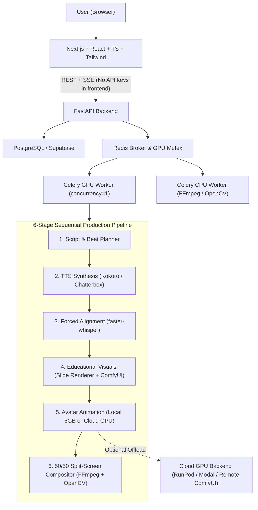

# System Architecture & Rendering Pipeline

## 1. Architectural Overview

**OpenSource AI Video Studio** is designed as a decoupled, queue-driven media production pipeline. Because the target development machine has **6 GB VRAM (RTX 3050 Laptop)** and **16 GB RAM**, the architecture enforces two core invariants:

1. **Sequential GPU Execution (Single-Model Mutex)**: Only one GPU-heavy model may occupy VRAM at any moment. Each pipeline stage acquires a Redis-backed GPU lock, executes, unloads weights (`del model; torch.cuda.empty_cache(); gc.collect()` or ComfyUI `/free`), and releases the lock before the next stage begins.
2. **Hybrid Local / Cloud Compute Abstraction**: Every AI engine implements a clean Python abstract base class (`TTSEngine`, `ASREngine`, `VisualEngine`, `AvatarEngine`). Heavy full-body/gesture diffusion models (`LongCat-Video-Avatar`, `EchoMimicV2`, `InfiniteTalk`) route to an optional **Cloud GPU Worker** while lightweight models (`Kokoro-82M`, `Chatterbox-Turbo`, `faster-whisper`, `Ditto`, `MuseTalk`, `SDXL-Turbo`) run locally.

---

## 2. High-Level System Diagram

---

## 3. End-to-End 2-Minute Video Pipeline

For a target **2-minute (120s)** educational video at **1920x1080 @ 25/30 fps**:

### Stage 1: Script Segmentation & Visual Beat Planning (CPU)
- Input: Raw script, target duration (e.g., 120s), character image, voice config.
- Estimates speaking rate (~140–160 words/min → ~280–320 words for 2 minutes).
- Splits script into **Scene Beats** (typically 8–16 beats of 7–15 seconds each), extracting:
  - Narration text per beat
  - Emotion tag (`neutral`, `enthusiastic`, `curious`, `serious`)
  - Visual type (`diagram`, `slide_bullets`, `code_block`, `ai_illustration`, `chart`)
  - Visual prompt / structured slide payload

### Stage 2: Voice & Audio Synthesis (`TTSEngine` - Local GPU/CPU)
- **Voice Selection**: `Kokoro-82M` (~1–2 GB VRAM, Apache-2.0) generates crisp narration per beat or full script.
- **Voice Cloning (Sample)**: `Chatterbox-Turbo` (~4–6 GB VRAM, MIT) clones speaker timbre from a 5–15s reference WAV.
- Outputs normalized 24kHz/48kHz WAV audio + exact segment durations.
- *VRAM cleanup executed before Stage 3.*

### Stage 3: Word-Level Timestamp Alignment (`ASREngine` - Local GPU)
- Runs `faster-whisper` (`small` or `medium` INT8, ~1.5–3 GB VRAM, MIT) on the synthesized narration.
- Produces exact **word-level timestamps** (`start`, `end`, `word`, `confidence`) and sentence boundaries.
- Re-anchors Stage 1 Scene Beats to exact spoken timestamps so visual transitions happen on the exact spoken word.
- Generates `.srt` / `.ass` subtitle tracks.
- *VRAM cleanup executed before Stage 4.*

### Stage 4: Educational Visuals Generation (`VisualEngine` - CPU + ComfyUI)
Educational videos fail when diffusion models try to render text directly. We use a **Hybrid Visual Engine**:
- **Programmatic Crisp Layer (CPU, 0 VRAM)**: Renders clean 960x1080 (or 960x1080 padded) educational slides, kinetic typography, bullet reveals, architecture diagrams (Mermaid/SVG/Cairo/Pillow), and charts with exact Whisper-timed animations.
- **AI Illustration Layer (ComfyUI API, <5.5 GB VRAM)**: Calls ComfyUI workflows (`SDXL-Turbo` FP16 or `SD 1.5`) for custom metaphors, icons, or background illustrations, then composites them into the programmatic slide frame.
- **Scene Analysis (PySceneDetect)**: Used when the user supplies reference video clips or B-roll to automatically detect shot boundaries and select clean visual segments without jarring mid-cut artifacts.

### Stage 5: Avatar Animation (`AvatarEngine` - Local 6 GB or Cloud GPU)
To handle 2-minute continuous generation without OOM or temporal drift, audio is processed in **chunked segments (e.g., 10–15s chunks with overlap/blending)** or streaming frames:
- **Local Mode (6 GB VRAM)**:
  - **Primary (`Ditto` / `antgroup/ditto-talkinghead`, ~3–5 GB VRAM, Apache-2.0)**: Generates natural head motion, blinking, facial expressions, and lip-sync directly from the character reference image + audio.
  - **Alternative (`MuseTalk` FP16, ~4 GB VRAM, MIT + `LivePortrait` pose/blink)**: High-accuracy lip-sync combined with expression/blink/head-pose driving.
  - *Hardware boundary*: Full-body hand gestures in local 6 GB mode are simulated via subtle upper-body breathing/sway and framing, because full-body diffusion requires >12–24 GB VRAM.
- **Cloud GPU Mode (Optional Backend)**:
  - Offloads the character image + full narration audio to a remote GPU worker running **EchoMimicV2** (upper-body + hand gestures, Apache-2.0), **InfiniteTalk** (Apache-2.0), or **LongCat-Video-Avatar** (MIT).
  - Streams back the rendered 960x1080 avatar MP4.

### Stage 6: 50/50 Split-Screen Compositor & Final MP4 Export (CPU - FFmpeg + OpenCV)
- **Layout**: `1920x1080` canvas:
  - **Left 50% (`960x1080`)**: Educational visuals (smooth cross-fades, kinetic bullet reveals, progress bar).
  - **Right 50% (`960x1080`)**: Animated avatar (center-cropped/framed upper body, optional subtle drop-shadow/divider, synchronized lip & expression).
  - *(Layout side and divider styling configurable per project.)*
- **Audio Mastering**: Loudness normalization (`loudnorm` to -16 LUFS) + optional subtle background music ducking.
- **Single Continuous Export**: Encoded with FFmpeg (`libx264`, `yuv420p`, `aac` 192kbps, `-movflags +faststart`) for universal browser and platform playback.

---

## 4. Frontend, Backend & Data Design

### Frontend (`Next.js` + `React` + `TypeScript` + `Tailwind CSS`)
- **Studio Workspace (`/studio`)**:
  - Script editor with beat markers & estimated duration counter (target: 2:00).
  - Character uploader + preview cropper (checks aspect ratio & face visibility).
  - Voice selector (Kokoro preset voices) OR custom voice sample uploader (Chatterbox).
  - Compute mode toggle (`Local 6GB Safe` vs `Cloud GPU - Full Gestures`).
  - Live SSE job progress tracker showing current pipeline stage (`TTS -> Alignment -> Visuals -> Avatar -> Compositing`).
  - Final MP4 player + download.
- **Security**: Frontend communicates *only* with FastAPI. Cloud GPU keys, DB credentials, and HuggingFace tokens remain strictly server-side.

### Database Schema (`PostgreSQL` / `Supabase`)
- `projects`: `id`, `title`, `script_text`, `target_duration_sec`, `compute_mode`, `layout_config`, `status`, `created_at`
- `assets`: `id`, `project_id`, `kind` (`character_image`, `voice_sample`, `visual_clip`, `final_mp4`), `storage_path`, `metadata_json`
- `scenes`: `id`, `project_id`, `order_index`, `narration_text`, `start_ms`, `end_ms`, `visual_type`, `visual_payload_json`, `emotion`
- `jobs`: `id`, `project_id`, `celery_task_id`, `current_stage`, `progress_pct`, `compute_target`, `error_message`, `started_at`, `completed_at`
