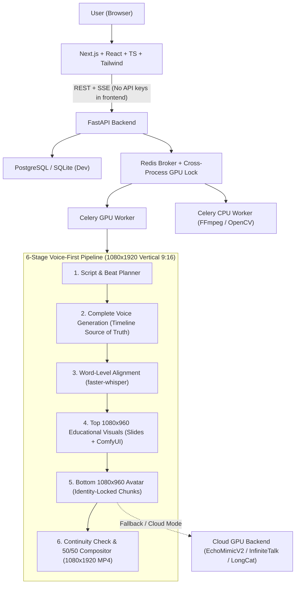

# System Architecture & Rendering Pipeline

## 1. Architectural Overview

**OpenSource AI Video Studio** is a decoupled, queue-driven media production pipeline producing **vertical 9:16 (1080x1920)** educational videos in a **top/bottom 50/50 split-screen layout** (Top: `1080x960` educational visuals; Bottom: `1080x960` animated avatar).

Because the target development machine has **6 GB VRAM (NVIDIA RTX 3050 Laptop)** and **16 GB RAM**, the architecture enforces nine core invariants:

1. **Vertical 9:16 Output (`1080x1920`)**: Top `1080x960` educational visuals + Bottom `1080x960` animated avatar.
2. **Cross-Process GPU Locking**: A distributed Redis lock (`SET NX EX` with heartbeat renewal) paired with an OS-level file lock (`storage/intermediate/.gpu.lock`) ensures no two processes (FastAPI, Celery workers, ComfyUI, or CLI tools) can contend for VRAM simultaneously.
3. **VRAM Monitoring & Automatic Model Unloading**: Real-time NVML (`pynvml` / `nvidia-smi` fallback) telemetry checks available VRAM before every GPU stage and forces deterministic unloading (`del model`, `torch.cuda.empty_cache()`, `gc.collect()`, ComfyUI `/free`) between stages or on threshold breach.
4. **Local / Cloud Model Fallback**: If local VRAM is insufficient, a CUDA OOM occurs, or the user requests full-body/hand-gesture diffusion (`EchoMimicV2`, `InfiniteTalk`, `LongCat-Video-Avatar`), the `ComputeRouter` automatically routes or falls back to the configured Cloud GPU backend.
5. **Complete Voice Generation as Timeline Source of Truth**: Stage 2 generates the **complete narration audio track first**. Stage 3 (`faster-whisper` forced alignment) derives the authoritative `Timeline` (total duration, scene beat start/end ms, word timestamps, captions) strictly from that completed audio.
6. **Character Identity Consistency**: A canonical **Character Identity Pack** (normalized portrait, face/upper-body crop anchor, reference seed/embedding, color-grade LUT, and boundary-frame conditioning) is persisted per project and passed to every avatar animation chunk.
7. **Frame & Audio Continuity Checks**: Adjacent segments are automatically verified at cut boundaries for perceptual/pixel continuity (SSIM / landmark delta) and audio/video sync drift (`|audio_dur - video_dur| < 40ms`), triggering seamless cross-fade or targeted re-render on seam failure.
8. **Automatic Retry & Recovery**: Celery tasks use exponential-backoff retries paired with per-stage JSON checkpoints (`storage/intermediate/<job_id>/checkpoint.json`), enabling resume from the last completed stage and automatic OOM fallback recovery.
9. **Modular Engine Abstractions**: Every AI capability (`TTSEngine`, `ASREngine`, `VisualEngine`, `AvatarEngine`) is interchangeable with zero vendor lock-in.

---

## 2. High-Level System Diagram

---

## 3. End-to-End 2-Minute Video Pipeline (1080x1920)

### Stage 1: Script Segmentation & Beat Planning (CPU)
- Input: Raw script, target duration (default: 120s), character reference image, voice selection/sample.
- Splits script into **Scene Beats** with emotion tags (`neutral`, `enthusiastic`, `curious`, `serious`) and visual specs (`diagram`, `slide_bullets`, `code_block`, `ai_illustration`, `chart`).

### Stage 2: Complete Voice Generation — Timeline Source of Truth (GPU/CPU)
- **Voice Selection**: `Kokoro-82M` (Apache-2.0, ~1–2 GB VRAM).
- **Voice Cloning**: `Chatterbox-Turbo` (MIT, ~4–6 GB VRAM).
- Generates the **complete, mastered narration audio** first. Its exact duration becomes the authoritative video duration.
- *Cross-process GPU lock released & VRAM unloaded.*

### Stage 3: Word-Level Timestamp Alignment (GPU)
- Runs `faster-whisper` (`small`/`medium` INT8, MIT) on the complete narration WAV.
- Produces exact word-level timestamps (`start_ms`, `end_ms`, `word`) and locks every Scene Beat's start/end time to spoken audio.
- Generates `.ass` / `.srt` caption tracks.
- *Cross-process GPU lock released & VRAM unloaded.*

### Stage 4: Top-Half Educational Visuals (`1080x960`, CPU + ComfyUI)
- **Programmatic Crisp Layer (CPU, 0 VRAM)**: Renders `1080x960` educational slides, kinetic bullet reveals, architecture diagrams, and charts synchronized to Stage 3 timestamps.
- **AI Illustration Layer (ComfyUI API, <5.5 GB VRAM)**: Generates custom illustrations via `SDXL-Turbo` FP16 / `SD 1.5` and composites them cleanly into the `1080x960` frame.
- **PySceneDetect**: Analyzes any user-supplied B-roll clips to avoid mid-shot cuts.

### Stage 5: Bottom-Half Avatar Animation (`1080x960`, Local 6 GB or Cloud GPU)
- **Character Identity Pack**: Normalizes the character image once (face/upper-body crop, seed lock, color reference) and passes it to all 10–15s chunks.
- **Local Mode (6 GB VRAM)**: `Ditto` (Apache-2.0, ~3–5 GB VRAM) or `MuseTalk` FP16 + `LivePortrait` (with commercial-safe detector) for lip sync, blinking, eye gaze, and head motion.
- **Cloud Fallback / Full-Body Mode**: Offloads to Cloud GPU (`EchoMimicV2`, `InfiniteTalk`, or `LongCat-Video-Avatar`) for upper-body & hand gestures, or automatically falls back if local VRAM check fails.

### Stage 6: Continuity Verification & Top/Bottom 50/50 Compositor (CPU)
- **Continuity Checks**: Verifies SSIM/pixel continuity and audio/video drift (`< 40ms`) across every segment boundary; applies micro cross-fades or triggers targeted segment re-render on failure.
- **Vertical 9:16 Compositing (`1080x1920`)**:
  - **Top (`y=0..960`, `1080x960`)**: Educational visuals.
  - **Bottom (`y=960..1920`, `1080x960`)**: Animated avatar.
  - **Audio**: `-16 LUFS` loudness normalization.
  - **Export**: Single continuous MP4 (`libx264`, `yuv420p`, `aac` 192kbps, `-movflags +faststart`).

---

## 4. Database & Recovery Design

- `projects`: `id`, `title`, `target_duration_sec`, `resolution` (`1080x1920`), `layout_mode` (`top_bottom_50_50`), `compute_mode` (`local_hybrid` | `cloud_preferred`), `status`, `created_at`, `updated_at`
- `scripts`: `id`, `project_id`, `version`, `raw_text`, `beats_json`, `estimated_duration_sec`, `created_at`
- `characters`: `id`, `project_id`, `name`, `reference_image_path`, `identity_pack_json`, `created_at`
- `voice_configs`: `id`, `project_id`, `engine` (`kokoro` | `chatterbox`), `preset_voice_id`, `sample_audio_path`, `speaking_rate`, `created_at`
- `jobs`: `id`, `project_id`, `celery_task_id`, `status` (`queued` | `running` | `retrying` | `completed` | `failed` | `cancelled`), `current_stage`, `progress_pct`, `retry_count`, `checkpoint_json`, `compute_target`, `output_mp4_path`, `error_message`, `started_at`, `completed_at`
- `job_logs`: `id`, `job_id`, `level`, `stage`, `message`, `vram_used_mb`, `created_at`
